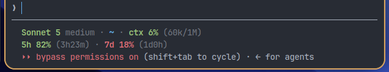

# claude-statusline

A lightweight, native Rust statusline for [Claude Code](https://docs.anthropic.com/en/docs/agents-and-tools/claude-code). It reads the session JSON from stdin and avoids spawning `jq`, `git`, or `date` for every update.



## Why use it?

- **At-a-glance context:** model, effort level, abbreviated working directory, Git branch, context usage, and available 5-hour / 7-day rate-limit information.
- **Low overhead:** a single native process instead of several shell subprocesses per render.
- **Local quota cache:** stores rate-limit snapshots under `~/.cache/claude/ratelimits.json` with file locking, so other local tools can read them.
- **Terminal-friendly:** uses standard 16-color ANSI output rather than fixed RGB colors.

**Supported prebuilt releases:** macOS (Apple Silicon and Intel), Linux (x86_64 and aarch64). Windows is not supported.

## Install with an AI coding agent

Copy this prompt to your coding agent:

~~~text
Help me install https://github.com/yesvus/claude-statusline.
Read INSTALL_PROMPT.md first. Check OS/architecture and whether
to build from source or trust an unsigned prebuilt release.
Preserve my existing Claude Code settings and ask before changes.
Verify the actual installed statusline and provide rollback.
~~~

[Full agent installation prompt](INSTALL_PROMPT.md).

## Install in under a minute

### Option A: Download a release

Paste into a Bash or Zsh terminal. This downloads the binary for your OS/CPU, fails on unsupported platforms, and installs into `~/.local/bin` without overwriting your Claude configuration.

```bash
(
  set -eu
  case "$(uname -s)-$(uname -m)" in
    Darwin-arm64) target=aarch64-apple-darwin ;;
    Darwin-x86_64) target=x86_64-apple-darwin ;;
    Linux-aarch64|Linux-arm64) target=aarch64-unknown-linux-gnu ;;
    Linux-x86_64) target=x86_64-unknown-linux-gnu ;;
    *) echo "Unsupported platform: $(uname -s)-$(uname -m)" >&2; exit 1 ;;
  esac

  tmp="$(mktemp -d)"
  trap 'rm -rf "$tmp"' EXIT
  mkdir -p "$HOME/.local/bin"
  curl --fail --location --retry 2 --output "$tmp/release.tar.gz" \
    "https://github.com/yesvus/claude-statusline/releases/latest/download/claude-statusline-${target}.tar.gz"
  tar -xzf "$tmp/release.tar.gz" -C "$tmp" claude-statusline
  install -m 755 "$tmp/claude-statusline" "$HOME/.local/bin/claude-statusline"
  echo "Installed: $HOME/.local/bin/claude-statusline"
)
```

For security, review release assets before installing executables. The archives are currently published without separate checksum files; signature/checksum verification is not yet provided.

### Option B: Build from source

Requires Rust:

```bash
git clone https://github.com/yesvus/claude-statusline.git
cd claude-statusline
cargo install --locked --path .
```

This installs to Cargo's binary directory (usually `~/.cargo/bin`) rather than `~/.local/bin`.

## Connect it to Claude Code

Open `~/.claude/settings.json`. **Merge** the `statusLine` property into your existing settings; do not replace other keys. Set `command` to the **absolute path** where you installed the binary:

```json
{
  "statusLine": {
    "type": "command",
    "command": "/absolute/path/to/claude-statusline",
    "padding": 0
  }
}
```

For the prebuilt install, run `echo "$HOME/.local/bin/claude-statusline"` to get that path; for a Cargo install, run `command -v claude-statusline`.

### Verify before opening Claude Code

```bash
printf '%s\n' '{"model":{"display_name":"Smoke test"},"context_window":{"used_percentage":25}}' \
  | "$HOME/.local/bin/claude-statusline"
```

If you installed via Cargo, replace the executable path with `$(command -v claude-statusline)`. The command should print a short colored statusline. Missing quota values are omitted, not invented.

## Performance comparison

Recorded on Linux x86_64 with 50 iterations; compare this historical measurement to your own environment rather than treating it as a universal speed guarantee.

| Metric | Bash + jq statusline | claude-statusline |
| --- | ---: | ---: |
| Mean elapsed time | 24.70 ms | 0.50 ms |
| Minimum / maximum | 11.29 / 97.27 ms | 0.43 / 1.02 ms |
| Child subprocesses per render | 6–8 | 0 |

The original benchmark fixture and runner are not included yet, so these figures are **not independently reproducible from this repository as-is**. The project needs a checked-in repeatable benchmark before making broader performance claims.

## Implementation notes

- Parses Claude Code's JSON from stdin, falling back gracefully when optional fields are absent.
- Reads Git branch from `.git/HEAD` rather than executing `git`.
- Writes quota cache files locally with an advisory lock; it does not fetch account quotas from the network.
- Uses the values provided by Claude Code (or the local cache); quota percentages may be unavailable or stale until fresh session data arrives.

## Feedback

If installation or rendering fails, [open an issue](https://github.com/yesvus/claude-statusline/issues/new) with your OS, CPU architecture, Claude Code version, and reproduction steps. Do not share session secrets or unredacted payloads.

## License

MIT © [yesvus](https://github.com/yesvus)
